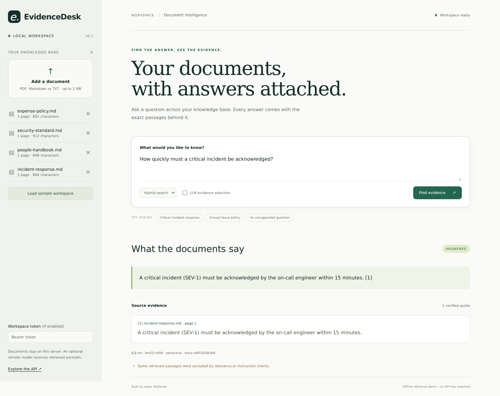
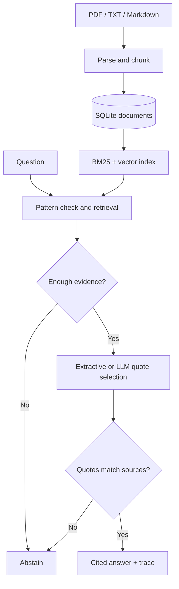

# EvidenceDesk

### Ask your documents. Inspect the evidence.

An evidence-first document assistant with hybrid retrieval, page-level citations, an optional LLM evidence selector, and reproducible evaluations. Built by **Jaber Mobarak** as an AI engineering project.



**Try it in five minutes:** install, load the fictional workspace, start the server, and open the browser. No API key or GPU is needed for the default retrieval demo.

```bash
python -m venv .venv
# macOS / Linux:
source .venv/bin/activate
# Windows PowerShell instead:
# .venv\Scripts\Activate.ps1
python -m pip install -e '.[dev]'
python -m evidencedesk.cli demo
python -m evidencedesk.cli serve
```

Open **http://127.0.0.1:8000**. The API docs are at **http://127.0.0.1:8000/docs**.

Ask: “How quickly must a critical incident be acknowledged?” Then inspect the returned quote and try an unsupported question such as “What is the office Wi-Fi password?”

## The engineering problem

Document assistants can retrieve a plausible passage and still produce an unsupported answer. EvidenceDesk separates retrieval, answerability heuristics, evidence selection, and source validation so each step can be tested. It uses an intentionally constrained answer format: accepted answers contain exact source excerpts, not unrestricted generated prose.

This is a working small-corpus portfolio application, not an enterprise production claim. The default mode uses classical NLP retrieval; enabling an LLM and learned embeddings adds real model inference. The modes are labeled in both the interface and API.

## What is implemented

| Capability | Implementation |
| --- | --- |
| Ingestion | PDF text extraction, Markdown, UTF-8 TXT; bounded uploads; page-preserving overlapping chunks |
| Retrieval | BM25 and character TF-IDF; reciprocal rank fusion; optional Sentence Transformers embeddings |
| Persistence | SQLite documents, content deduplication, index invalidation after mutations |
| Answers | Exact source quotes with document, page, chunk ID, and ranking score |
| LLM integration | OpenAI-compatible HTTP endpoint, JSON evidence selection, exact-quote validation, fail-closed model errors |
| Answerability | Similarity and token-overlap heuristics, explicit abstention; known false positives are reported |
| API and UI | FastAPI/Pydantic, OpenAPI docs, responsive browser interface, bearer-token option |
| Observability | Request ID, backend, latency, bounded aggregate telemetry without raw query logging |
| Quality | Integration tests, 40 authored benchmark cases, retrieval ablations, GitHub Actions |
| Packaging | Docker, Compose, local CLI, self-contained Colab notebook |

The offline “vector” baseline is a sparse **TF-IDF vector space**, not a neural embedding model. The optional semantic mode uses normalized learned embeddings and exact in-memory dot-product search. There is no external vector database in this version.

## Architecture



The index is cached in process and rebuilt after writes. The supported deployment is one application worker. Multiple workers would need shared index versioning; horizontal scaling is deliberately outside this version.

## Run in Docker

```bash
docker compose up --build
```

Compose binds to localhost and retains the SQLite file in a named volume. Click **Load sample workspace** in the UI. The Docker image runs as a non-root user. Docker build instructions are supplied; see [validation status](docs/VALIDATION.md) for what was actually executed.

## Enable learned embeddings

```bash
python -m pip install -e '.[semantic]'
# Linux/macOS:
export ED_EMBEDDING_MODEL=sentence-transformers/all-MiniLM-L6-v2
# Windows PowerShell instead:
# $env:ED_EMBEDDING_MODEL='sentence-transformers/all-MiniLM-L6-v2'
python -m evidencedesk.cli serve
```

The first query downloads the model and builds the index; internet access and enough memory are needed. Retrieval becomes BM25 plus learned dense embeddings. The `0.12` similarity threshold was chosen for the offline demo and needs independent calibration for a different embedding model and corpus. Read the separate measured [MiniLM benchmark](reports/semantic-benchmark.md) rather than treating the TF-IDF numbers as neural-model results.

## Enable an LLM locally

Install and run [Ollama](https://docs.ollama.com/), then use a model your hardware supports. Example:

```bash
ollama pull qwen2.5:3b
export ED_LLM_BASE_URL=http://localhost:11434/v1
export ED_LLM_MODEL=qwen2.5:3b
python -m evidencedesk.cli serve
```

For Windows, set environment variables with `$env:NAME='value'`. Enable **LLM evidence selection** in the interface. Ollama needs to be running on the same machine as the API. From Docker, `localhost` refers to the container, so configure an endpoint reachable from that container instead.

The model returns up to three exact quotes and their chunk IDs. The server rejects malformed JSON, invented quotations, unknown IDs, and flagged passages. A failed model call produces abstention rather than an unverified fallback. A valid empty evidence list also produces abstention. If no model is configured, the UI request falls back to the explicitly labeled extractive demo.

An optional compatible hosted endpoint can be configured through `ED_LLM_BASE_URL`, `ED_LLM_MODEL`, and `ED_LLM_API_KEY`. This sends the question and retrieved excerpts to that provider. Use documents you are authorized to send. The endpoint is server configuration and cannot be supplied by document content or an API request.

### Local Qwen through Transformers

If you prefer Python over Ollama, the package also includes a small development adapter:

```bash
python -m pip install -e '.[semantic]'
python -m evidencedesk.local_model --model Qwen/Qwen2.5-1.5B-Instruct
```

In a second terminal, set `ED_LLM_MODEL=Qwen/Qwen2.5-1.5B-Instruct` and start EvidenceDesk. The default base URL already points at this local adapter. It downloads real pretrained weights and chooses CUDA when available, otherwise CPU. This small model is for an inexpensive demonstration; its evidence selection can fail, and failed validation produces abstention. The adapter implements only the chat-completion subset used here. It does not provide constrained decoding, batching, authentication, or general inference serving. See the [validation record](docs/VALIDATION.md) for live-test scope.

## API example

```bash
curl -X POST http://127.0.0.1:8000/api/demo
curl -X POST http://127.0.0.1:8000/api/ask \
  -H 'Content-Type: application/json' \
  -d '{"question":"What is the meal reimbursement limit?","mode":"hybrid","top_k":4}'
```

Other endpoints: `POST /api/documents` (multipart file), `GET /api/documents`, `DELETE /api/documents/{id}`, `GET /api/metrics`, `GET /api/config`, `GET /health`.

If `ED_API_TOKEN` is set, use `Authorization: Bearer <token>` for all `/api/*` routes. The browser's token field keeps the token in page memory only. Environment variables are read at startup; restart the service after changing them. `.env.example` is a reference; the Python service does not automatically load `.env` files. Compose reads `.env` for substitution.

## Reproduce validation

```bash
python -m ruff check .
python -m pytest -q
python -m evidencedesk.cli evaluate --output reports/benchmark.json
```

Read the measured [benchmark table](reports/benchmark.md) and [per-question JSON](reports/benchmark.json). The 40 questions include 28 answerable, 8 unsupported, and 4 instruction-override patterns. Metrics are intentionally named narrowly: document hit rate, document MRR, expected evidence substring match, refusal rate, and warm-query latency. They do not measure unrestricted generative answer quality.

## Colab

Open `notebooks/EvidenceDesk_Colab.ipynb` in Google Colab and choose **Runtime → Run all**. It contains the application source as an embedded archive, installs it, runs a real end-to-end demo, evaluates it, and opens the interface through Colab's authenticated port proxy. It does not depend on a placeholder GitHub repository URL or a secret key. Learned MiniLM embeddings are enabled by default. Local Qwen is an optional switch; a GPU is recommended for it. Turn off learned embeddings if you want the fastest offline baseline after installation.

## Limits and tradeoffs

- Exact-quote validation proves that a quote appeared in the retrieved text. It does not establish factual truth, document authority, completeness, or relevance.
- The offline answerability gate is heuristic. Related but unsupported questions can still receive an irrelevant quote. The included adversarial cases make that failure visible.
- Prompt-injection filtering is a small pattern check plus constrained model output, not a comprehensive defense. Obfuscated attacks can evade it, and legitimate text can be excluded.
- Fictional English demonstration data is hand-authored; no measured accuracy claim applies to private, multilingual, scanned, or large document collections.
- PDFs must contain text; OCR, layout-aware tables, tenant permissions, rate limits, audit-grade logging, and distributed indexing are not implemented.
- Document content is stored in plaintext SQLite on the server. Raw questions are not logged, but query hashes are not anonymization for guessable questions.
- Run on localhost for the demo. A shared deployment needs HTTPS, stronger authentication, worker/resource limits for hostile PDF parsing, and an operational review.

## Repository guide

- `src/evidencedesk/`: ingestion, retrieval, model adapter, service, API, CLI, frontend, authored demo data.
- `tests/`: behavior and integration coverage, including mocked model and embedding contracts.
- `reports/`: measured benchmark and failure cases.
- `notebooks/`: self-contained Colab experience.
- `docs/`: architecture decisions, current hiring research, interview guide, and validation record.

See [why this project](docs/HIRING_RESEARCH.md), [design decisions](docs/DESIGN.md), and [interview preparation](docs/INTERVIEW_GUIDE.md).

## License and authorship

MIT. Fictional sample policies and questions were authored for this project. The project was built with AI assistance. Before presenting it as evidence of your skills, reproduce the demo, inspect the failure cases, and be able to explain the retrieval and validation decisions. Do not claim model training, production traffic, or unmeasured improvements.
